<h1 align="center">UltraPals</h1>

<p align="center"><b>An AI team that can do real work, and cannot decide where real money goes.</b><br/>
A lead agent, specialist Pals with their own domains and effort levels, and one pure function that is the only thing allowed to move PayPal sandbox money.</p>

<p align="center">
  
  
  
  
</p>

<p align="center"><a href="https://ultrapals.onrender.com"><b>Open the live demo</b></a> · <a href="docs/DEMO-SCRIPT.md">3-minute tour</a> · <a href="docs/README.md">All docs</a> · built for the PayPal AI Hackathon, November 2026</p>

<p align="center">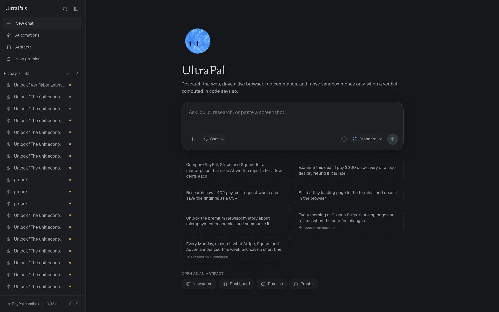</p>

---

## Walkthrough: every mode
The pill at the bottom left of the prompt box picks the mode. **The picture above the title changes with it**: in Battle and Loop, UltraPal is joined by one orb for every team or round you pick, and they play a short, silent demonstration of how that mode works. It plays once each time you switch into the mode (press **Replay** to see it again).
> The demonstration is an illustration. Nothing has run yet, so its scores are fixed stand-ins. What is real in it: the number of orbs, the bracket and its byes, the health arithmetic of every hit (the same `duel` and `replay` code the real Battle uses), and the rule each Loop round follows. A real run replaces the stand-ins with live teams and a blind judge.

### Chat: one UltraPal
Ask anything. UltraPal answers, sends out Pals when it needs them (research, a live browser, a terminal), and the context ring adds up the whole team while they work. Nothing else on the screen changes.

### Battle: teams argue, a knockout picks one
<p align="center">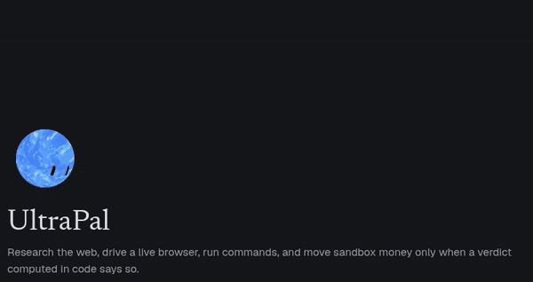</p>

1. Switch **Chat** to **Battle**. The title becomes *UltraPal Battle* and **one orb pops in per team**.
2. Two teams step up onto the stage. Each **lunge, hit and recoil** is a frame of the real Battle replay: the orb is squashed along the line of the hit, a ring flashes where they touch, and a health bar drops by the damage on that measure (evidence, consistency, calibration, actionability, fit).
3. The loser sinks and fades, the winner recovers a little health and goes on, and the last orb standing is lit as champion. With 3, 5 or 6 teams some orbs get a **bye**, exactly as in the bracket.
4. Type a question and press send to run it for real: each team gets its own cloud computer and a different model family, the judge never sees persona names, and the fight is decided by arithmetic (see [`docs/BATTLE-AND-LOOP.md`](docs/BATTLE-AND-LOOP.md)).

### Loop: each round must beat the last
<p align="center">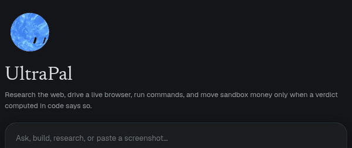</p>

1. Switch to **Loop**. **One orb pops in per round** (the default is 5), each inside a ring of five parts, one for each measure the judge gives.
2. **One orb at a time turns once, all the way round**. While it turns, its ring is drawn: each part fills in proportion to that measure.
3. The part that came out lowest is marked. A **baton** ("aim: calibration") carries it across to the next orb, which shows a small tick where the last round left that measure. That round is told to beat it, and the part it was aimed at fills past the tick.
4. The scores climb and slow down. The best round is crowned. With 6 rounds, round 6 does not beat round 5, so the Loop **stops with round 5**: the same rule the real Loop uses (a score of 8 or more that the next round did not beat).

### The number is the number of orbs
<p align="center">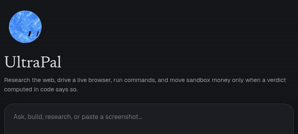</p>

The count menu next to the mode pill (**2 teams**, **5 rounds** ...) sets how many orbs there are, and the sentence under the title says what that count means (*"6 teams argue opposite predictions, ...: quarter-finals with 2 byes"*). Orbs that were already there stay; new ones pop in; a different count starts the demonstration again.

### Automations: Pals that work while you sleep
Open **Automations** in the sidebar, or just ask in the chat with a time word in your own message (*"every morning, watch this page and tell me when the price changes"*). There are eight kinds, including a Battle and a Loop on a schedule, each with its own ceiling. A run cannot move money and cannot create more automations. See [section 5](#5-automations-pals-that-work-while-you-sleep-inside-ceilings-no-prompt-can-lift) below.
<p align="center">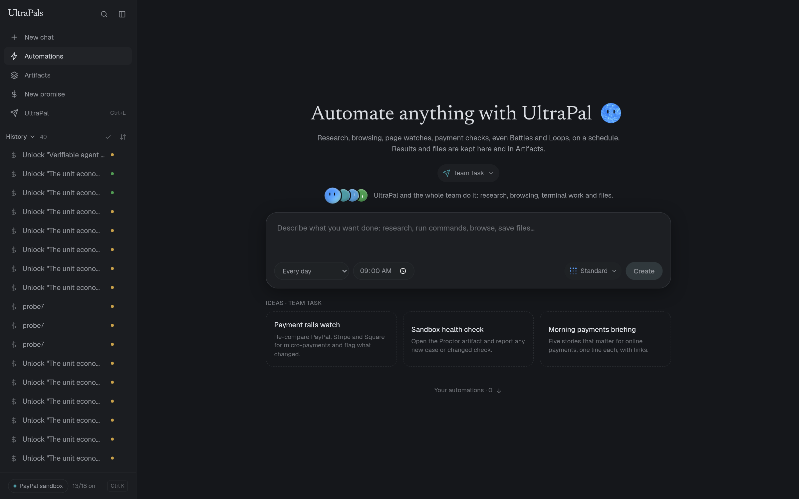</p>

### And the money path
Ask UltraPal to *"Unlock the premium Newsroom story about micropayment economics and summarise it"*. A promise is created, the sandbox order is approved on a live browser, the pure verdict function decides, and **Replay verdict** gives the identical answer later. See [section 6](#6-the-money-path-in-the-open) below.

---

## The problem

An agent that can click **Pay** is one confident hallucination away from your money. Today the line between "the model thought it was fine" and "money left the account" is a prompt, and a prompt can be argued with.

PayPal has 439 million accounts and says "transaction margin dollar growth is our North Star" ([Q3 2026 call](https://tickertrends.io/transcripts/PYPL/Q3-earnings-transcript-2026)). On its Q4 2025 call, management said agentic commerce "won't materially impact 2026 growth" and that merchants "require much more hands-on integration support than we anticipated" ([transcript](https://www.fool.com/earnings/call-transcripts/2026/02/03/paypal-pypl-q4-2025-earnings-call-transcript/)). The gap between *agents can shop* and *anyone will let them* is trust.

**We figured out that the line should not be a prompt. It should be a function.** So we built UltraPals around that one idea:

* A payer commits an amount and an optional condition about the world (a product price, a page's text).
* A **pure function** (`lib/verdict.ts`: no network, no clock, no model) returns `CAPTURE`, `RELEASE` or `WAIT`, and the verdict **carries its own consequence**.
* **One route** performs it against the PayPal **sandbox**.
* Everything else, all the research, browsing, arguing and scheduling, is done by Pals that **gather and propose and are forbidden, by a build-failing check, from importing the function that decides**.

> *Not seeing is not the same as no.* If an observer is blind, the answer is `WAIT`, never `RELEASE`. That one rule is enforced in the types and in a test table, and it is the difference between a safe agent and a lucky one.

## Try it in 60 seconds

Open the [live demo](https://ultrapals.onrender.com) and paste one of these (they are also the suggestion chips on the home screen):

| Paste this | What you will see |
|---|---|
| `Research how L402 pay-per-request works and save the findings as a CSV` | ResearchPal runs Tavily and Exa in parallel, writes a cited answer and a CSV, and the **context ring** counts the whole team's tokens live |
| `Build a tiny landing page in the terminal and open it in the browser` | TerminalPal writes files (green and red diffs) in a cloud VM; BrowserPal opens the result in a **live cloud Chromium** you can watch |
| `Examine this deal: I pay $200 on delivery of a logo design, refund if it is late` | **Deal exam**: RivalPal attacks the real verdict with ten hostile worlds and prints a ladder and a seal |
| `Compare PayPal, Stripe and Square for a marketplace that sells AI-written reports for a few cents each` | **Case Desk**: every rail answered with a cited quote, or honestly marked unknown |
| `Unlock the premium Newsroom story about micropayment economics and summarise it` | PromisePal creates a promise, approves the sandbox order on the live browser, asks the money route, and reads the unlocked article |
| Switch **Chat** to **Battle** (the pill at the bottom left of the prompt box) and ask a question | 2 to 6 teams argue opposite predictions, a blind judge scores them, a knockout crowns one |

The sandbox is real PayPal sandbox. No real card, no real money, ever (a live key or `api.paypal.com` fails the build).

## What is in it

### 1. A context meter for the whole team, in real time

An IDE-style context meter, except the "conversation" is a team. One ring beside the effort selector adds up UltraPal **and every Pal it sent out**, token by token, while they stream. Hover for each agent's bar, the model it is on right now, and what it is doing ("Waiting to hear from…", "Hearing…", "Opening https://…"). **Show all tool calls** unfolds, with animation, each agent's calls, tokens, steps, commands, files, searches and pages. Battles get one ring per team, Loops one per round, plus a ring for the judge and the writer.

<p align="center">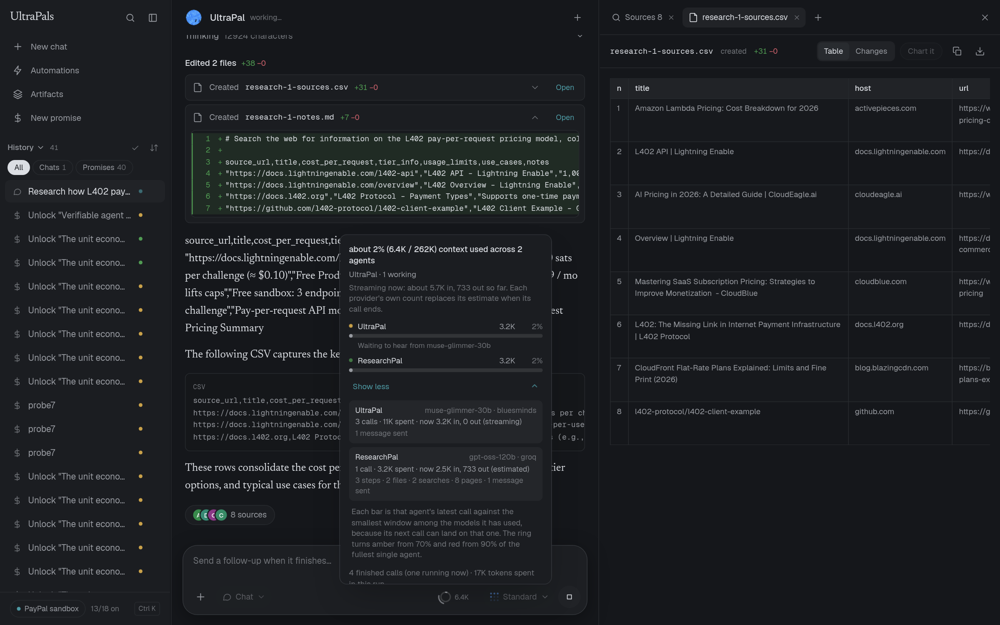</p>

It matches the event stream token for token (we compared them in a real browser, sample by sample), it does not close while text streams, and the window it measures against is the smallest among the models an agent has used, so a free-tier rotation cannot swing the denominator under your feet.

### 2. Every Pal has its own panel

Click any agent in the thread. You get its task, the models it used and how many tokens each took, every command it ran, every file it touched (as a diff), every search and the exact pages it read with the `[n]` citation each got.

<p align="center">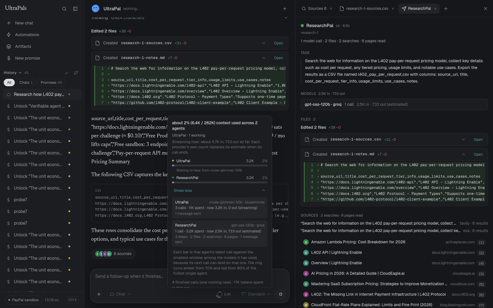</p>

### 3. Pals that get stronger on request

The effort pill changes which allowlisted models lead, how many race each call, and how many planning rounds UltraPal gets. It never reaches a model that is not on the server's roster.

<p align="center">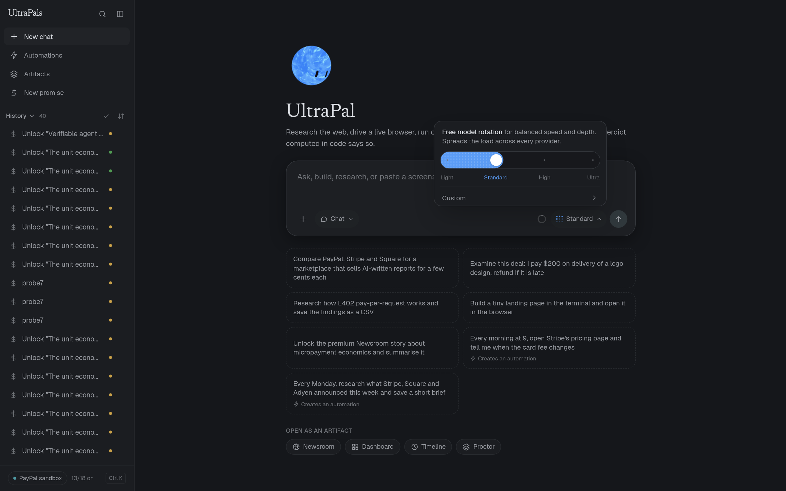</p>

| Level | Leads with | Models raced | Planning rounds |
|---|---|---|---|
| Light | GPT-OSS 20B | 2 | 4 |
| Standard | free-model rotation across every provider | 2 | 6 |
| High | GPT-OSS 120B | 2 | 6 |
| Ultra | Nemotron 3 Ultra 550B | 3 | 8 |
| Custom | one pinned model, the rest as fallback | 1 | by level |

### 4. Battle and Loop: an answer has to be earned

One confident agent is the failure mode, not the feature.

* **Battle**: 2 to 6 teams, each on its own cloud computer and a **different model family**, argue *opposite predictions*. A blind judge (persona names scrubbed) scores each report, a knockout bracket decides, and the fight is arithmetic, not animation: health, damage per measure, armour per cited source. Forty percent of every score is counted by code (sources, files, finishing cleanly) and sixty percent is the judge's.
* **Loop**: each round attacks the weakest point of the best answer so far and is told what it must beat. It stops on a score of 8 or more that the next round did not beat, two flat rounds, or the round limit. The screen shows what changed between rounds.

<p align="center">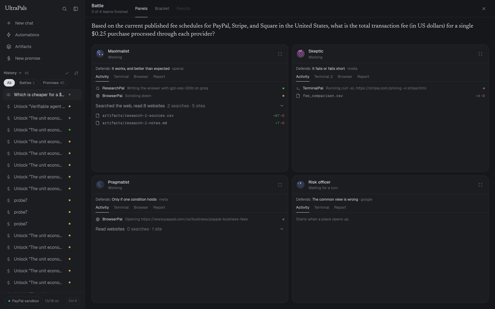 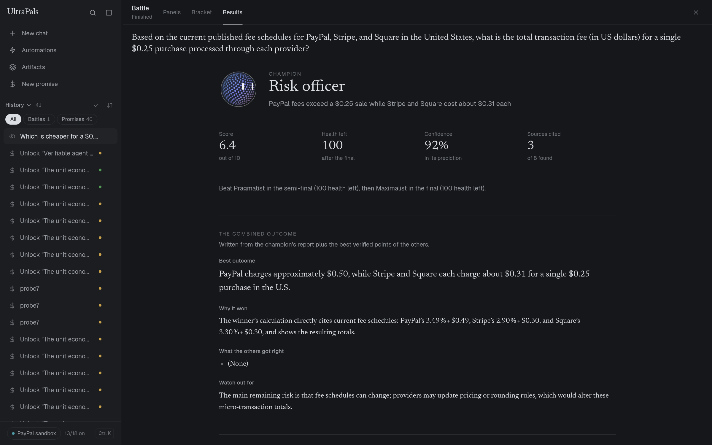</p>

Details, the arithmetic and the limits: [`docs/BATTLE-AND-LOOP.md`](docs/BATTLE-AND-LOOP.md).

### 5. Automations: Pals that work while you sleep, inside ceilings no prompt can lift

Eight kinds (Team task, Research brief, Browser task, **Page watch**, Rail check, Deal exam, Battle, Loop), each with its own shortest interval, daily cap and time limit. Money and self-replication are denied inside every run. A schedule can only be created when **the user's own message contains a time word**, so a web page cannot talk UltraPal into creating a job. A page watch's verdict is a word that **code** parses (`BASELINE`, `CHANGED`, `UNCHANGED`), not a model's tone.

<p align="center"></p>

### 6. The money path, in the open

Create a promise, settle it, watch each agent in the trace, then press **Replay verdict** and get the identical answer from the stored input, even though the world has moved since.

<p align="center">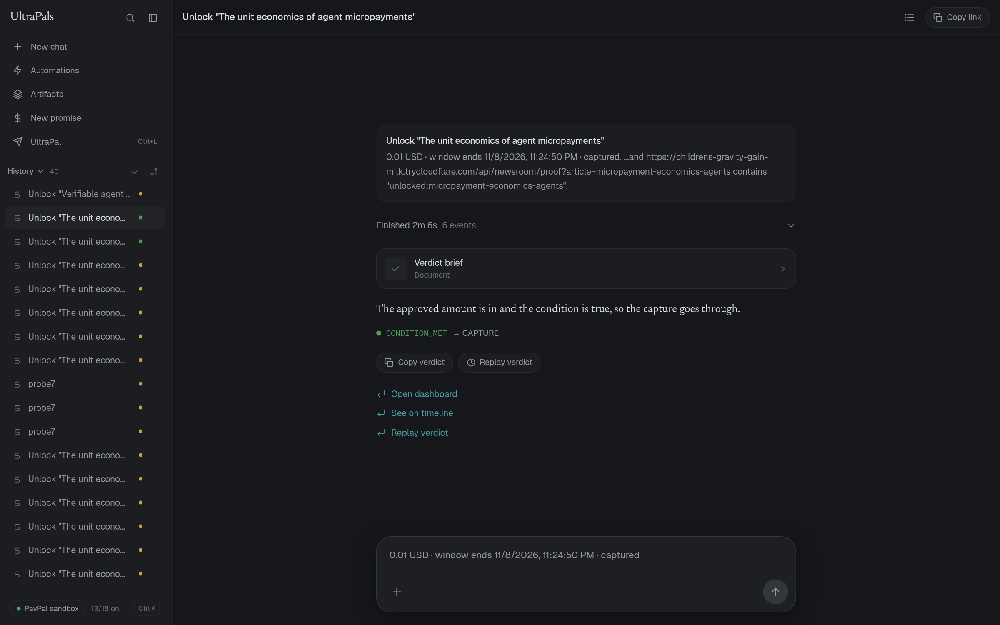 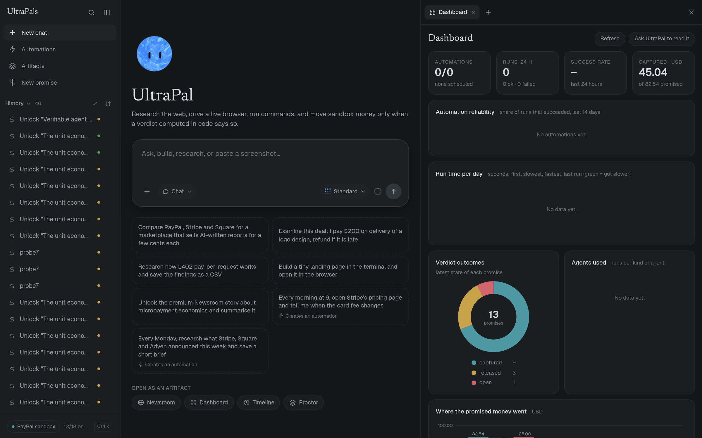</p>

Dashboard, Timeline, Newsroom and Proctor are **artifacts** UltraPal can open next to the chat. [`docs/SYSTEM.md`](docs/SYSTEM.md) has the decision table, the state machine and the sequence diagram.

## Ultra, Super and normal Pals

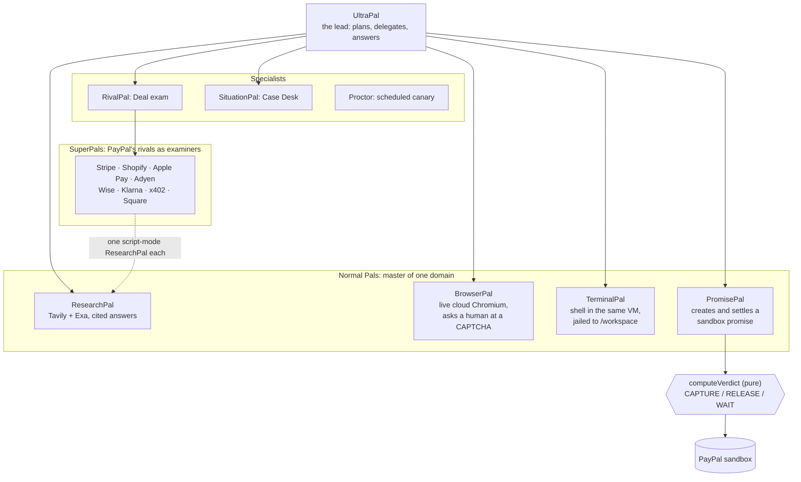

* **Normal Pals** each have one domain and a hard list of tools. None can touch the database or compute a verdict.
* **Specialists** do the jobs that need a rulebook: RivalPal examines a deal before it ships (*cite or die*: a rival survives only if every quote is a substring of a page that was actually fetched), SituationPal compares payment rails, Proctor is a scheduled canary that costs zero model calls.
* **SuperPals** are PayPal's rivals turned into examiners with a **frozen roster** and structure-only bars (never milliseconds or fees). A missing key reports `NOT_MEASURABLE` with the env name, never a pass, and **a rival row never gates the seal**.
* A child's tools and budget are the **intersection** of its parent's. The tool enum has no PayPal, database or money member, so no Pal at any depth can be handed one.

Full tables: [`docs/PALS.md`](docs/PALS.md).

## What we figured out, and what we built because of it

| We figured out that… | …so we built |
|---|---|
| "I checked" from an agent proves nothing | **Cite or die**: a claim survives only if its quote is a verbatim substring of a page the fetcher actually read |
| The most dangerous word in payments is *couldn't see* | `FACT_MISSING` is `WAIT` in every window state. Blind never means no |
| A verdict you cannot replay cannot be audited | Every verdict stores its own input; `GET /api/verdict/replay` recomputes it with the same pure function |
| One confident agent is a failure mode | **Battle and Loop**: opposite predictions, a blind judge, arithmetic damage |
| Unattended agents are a spending risk | **Automations** with per-kind ceilings, no money, no self-replication, a schedule needs a time word from the human |
| Nobody can see what an agent team is costing | **The collective context ring** and a panel per Pal |
| Free models stall and rate-limit | A ten-model roster across four providers with cool-downs, hedged races, and a rule that a model silent for 15 seconds is dropped for the next |

## How the money path stays honest

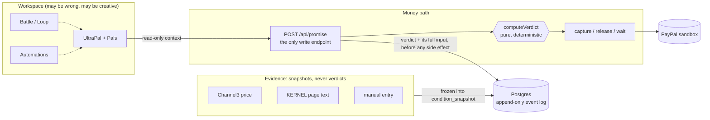

Seven laws, each enforced by a hook or a script (the build fails if one is broken): verdicts are pure; money is integer minor units; agents gather and never decide; sandbox only; `npm run verify` is green before every commit; vendors produce snapshots and never verdicts; no vendor endpoint or field is written from memory. The table is in [`docs/SYSTEM.md`](docs/SYSTEM.md#the-seven-laws-each-one-is-enforced-by-a-hook-or-a-script).

## Where this sits, honestly

We did a prior-art pass before writing this, and **we do not claim to have invented** escrow, mandates, agent wallets, dispute evidence, adversarial agent testing or a payment state machine. Close neighbours include Google AP2, Visa Trusted Agent Protocol, Mastercard Agent Pay, Skyfire, Payman, Crossmint, PayPal Doctor, Gauntlet, FetchSandbox, HoldSpec, Sentinel ProofLayer, Chargeflow and Justt.

What we claim is a **combination and a discipline**: one workspace where the agent does real work *and* real sandbox money is gated by a function it cannot import; replayable verdicts; rivals as cite-or-die examiners; judged multi-agent contests; and unattended agents with hard ceilings. Each claim, and how to check it, is in [`docs/LANDSCAPE.md`](docs/LANDSCAPE.md), together with a list of what we are **not** good at.

## What it could be worth to PayPal

A **sensitivity model, not a forecast**. Every input is a published PayPal figure (cited) or a labelled assumption.

| | |
|---|---|
| PayPal FY2025 | $1.79T total payment volume, $15.5B transaction margin (0.866% of volume), about $1.25B transaction losses (0.07%) |
| Margin riding on agent-initiated volume | **$155M** at 1% of volume, **$775M** at 5%, **$1.55B** at 10% |
| Attributable to a verifiable trust layer | conservative case (5% agent share, 10% of margin retained): **about $78M a year**, plus **$12M to $63M** from a 1% to 5% cut in losses, so **roughly $90M to $140M a year**. The optimistic corner is above $300M |

**Billions are at stake. Billions are not what this one project captures**, and we say so. Assumptions, the mechanism-to-KPI table and a one-command reproduction: [`docs/PAYPAL-IMPACT.md`](docs/PAYPAL-IMPACT.md).

## Sponsors and integrations

Every vendor sits behind a `CAP_*` flag. Switched off, the product stays fully usable (that is the acceptance test).

| Sponsor | What it does here | In the live demo |
|---|---|---|
| **KERNEL** | the cloud Chromium and shell VM; page reads; replay evidence | on |
| **AG Studio** | dashboard with custom widgets; an analyst agent that explains verdicts | on |
| **Channel3** | resolves `price_at_most` conditions to the cheapest in-stock offer | on |
| **Bryntum** | the Timeline: drag a bar and the due date moves | on |
| **Render** | hosts the live demo: one web service in Singapore with a disk for automations | on. The Workflows sweep adapter is built and tested, switched off |
| **Elastic** | precedent search with hybrid retrieval | built and tested, switched off |
| **Zapier** | friendly email nudges over MCP | built and tested, switched off |
| **Astropods** | a hosted Promise concierge agent | built and tested, switched off |
| **APIMatic** | verified our PayPal Orders calls against the generated SDK | build-time, trail in [`docs/APIMATIC-LOG.md`](docs/APIMATIC-LOG.md) |
| **Postman** | a collection with tests, run with `newman` | `npm run test:api` |

Per vendor detail, including what was and was not verified against a live account: [`docs/INTEGRATIONS.md`](docs/INTEGRATIONS.md).

## Tested

* **2,478 tests in 143 files**, plus 10 mechanical invariant checks that fail the build (pure verdict, reason codes in sync, no floats on the money path, INR not payable, agents never call `computeVerdict`, adapters use `guard()`, sandbox only, no `any`, protected files keep their markers).
* The verdict table, money maths, the arena (blind judge, bracket, duel), the automation ceilings, the cite-or-die verifiers, the event reducer and the context maths are all pure and tested without a network.
* **We also ran it.** Tests did not find these; running did, and each is now a regression test: a paced display queue that froze after the first burst of events, a context ring that fell silent while a model was slow to answer, a hover card that closed whenever text streamed, a scheduling gate that fired on "a few cents each".
* Not tested, said plainly: live vendor calls (they depend on keys and free tiers), and sandbox behaviour in production. See [`docs/TESTING.md`](docs/TESTING.md).

```bash
npm run verify:fast   # invariants + typecheck + tests, about 10 seconds
npm run verify        # the above + next build; required before every commit
```

## Run it yourself

```bash
git clone https://github.com/abhyudaya874-ai/ultrapals && cd ultrapals
npm ci
cp env.example .env.local   # fill DATABASE_URL (Neon), PAYPAL_CLIENT_ID/SECRET (sandbox), and any model/search keys you have
npx drizzle-kit migrate
npm run dev                 # http://localhost:3000
```

Only the database and the PayPal sandbox keys are required. Every other key turns one capability on, and a missing key turns it off cleanly. Deployment on Render, what it costs and how it is capped: [`docs/DEPLOY.md`](docs/DEPLOY.md).

## Honest limits

* **Sandbox is not production.** It proves the mechanism and the state machine. It does not prove fraud reduction or conversion.
* **Free models are inconsistent.** The whole stack runs on free-tier APIs, so a run can be slow, and sometimes a provider is simply down (we watched one return 503 on every model while writing this). The app rotates, races and drops silent models, but it cannot make a free tier fast.
* **There is no login.** Anyone who can reach the app can use it, inside hard ceilings. Per address: 6 messages and 2 contests a minute. For everyone together, every day: 250 messages, 30 Battles or Loops, 150 cloud computers started and 6 alive at once (the code enforces these so a public link cannot run up anyone's bill; see [`docs/DEPLOY.md`](docs/DEPLOY.md)). If the day's budget is used up the app says so and frees up as the 24 hours roll over.
* **Several SuperPal rows read `NOT_MEASURABLE`** until the matching sandbox key is supplied. That is by design.
* **A fee question on the open web can come out unflattering to PayPal.** A real Battle we ran on "fee for a $0.25 purchase" crowned a team that found PayPal's fixed fee dominates a micropayment. The product reports what the sources say. That is the point of a cite-or-die exam.

## A note from the builder

UltraPals was built by a student in India, for this hackathon, on free tiers: free model APIs, free search quotas, a PayPal sandbox, a Neon free database and the Render credits the hackathon gave us (the live demo runs on the smallest always-on instance, about $7 a month). There are no GPUs and no paid keys behind it. That is why so much of the engineering is about *not wasting a call*: a ten-model roster with cool-downs (the live site runs six of them, because the credit-funded gateway is switched off), hedged races, a deadline on silent models, ceilings on everything unattended.

If a run is slow when you try it, it is almost always a free model having a bad minute, not the product. Try it again, or pick **Light** or **High** in the effort pill to lead with a different model. Thank you for spending time on it.

## Documentation

| | |
|---|---|
| [`docs/DEMO-SCRIPT.md`](docs/DEMO-SCRIPT.md) | the 3-minute tour, second by second |
| [`docs/PALS.md`](docs/PALS.md) | Ultra, Super and normal Pals; effort; providers |
| [`docs/SYSTEM.md`](docs/SYSTEM.md) | the money path, decision table, state machine, safety posture |
| [`docs/BATTLE-AND-LOOP.md`](docs/BATTLE-AND-LOOP.md) | the arena, the arithmetic, the limits |
| [`docs/AUTOMATIONS.md`](docs/AUTOMATIONS.md) | the eight kinds and their ceilings |
| [`docs/PAYPAL-IMPACT.md`](docs/PAYPAL-IMPACT.md) | what this could be worth, with every assumption |
| [`docs/LANDSCAPE.md`](docs/LANDSCAPE.md) | prior art and what we are not good at |
| [`docs/INTEGRATIONS.md`](docs/INTEGRATIONS.md) | sponsor by sponsor, verified vs not |
| [`docs/TESTING.md`](docs/TESTING.md) | what is tested, how, and what is not |
| [`docs/DEPLOY.md`](docs/DEPLOY.md) | running it on Render |
| [`docs/ARCHITECTURE.md`](docs/ARCHITECTURE.md), [`docs/CODEMAP.md`](docs/CODEMAP.md), [`docs/DECISIONS.md`](docs/DECISIONS.md) | for contributors: every file and export, and why choices were made |

Repository map: `app/` routes and pages · `components/` UI (agent, arena, automations, shell, thread) · `lib/verdict.ts` the pure decision · `lib/computer/` UltraPal and the Pals · `lib/arena/` Battle and Loop · `lib/pals/` Deal exam, SuperPals, Case Desk · `lib/automations/` · `lib/usage/` the context maths · `lib/integrations/` vendor adapters · `db/` and `drizzle/` schema and migrations · `scripts/` the invariant checks · `reference/` the starter pack's reference code and its tests.
