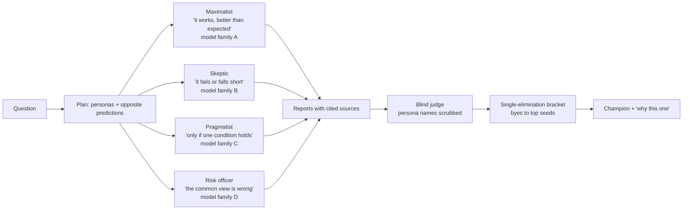
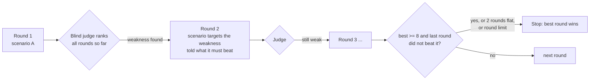

# Battle and Loop

A single agent that answers confidently is the failure mode, not the feature. UltraPals has two modes that make agents *earn* an answer.

| | Chat | Battle | Loop |
|---|---|---|---|
| Who works | one UltraPal | 2 to 6 teams, in parallel | one team per round, up to 6 rounds |
| Idea | answer | teams **argue opposite predictions**, a blind judge and a knockout pick the best-supported one | each round attacks the weakness the judge found in the best answer so far |
| Every team gets | n/a | its own persona, its own model family, its own cloud computer | a fresh scenario |
| Ends when | the answer is written | the bracket has a champion | round limit, score of 8+ that the next round did not beat, or two rounds without improvement |

## Who sets the scenarios

All three options produce the same `Plan` and pass the same `planProblems` checks before anything runs.

* **Autopilot**: UltraPal drafts it and starts. A Loop on Autopilot is *adaptive*.
* **AI draft**: a model drafts, the person edits and approves in the plan dialog.
* **I set it**: the person writes every slot.

A Battle needs different personas and at least two different predictions. A Loop needs a distinct scenario in every round.

## Battle

Each team runs in its own session on its own cloud computer, pinned to a **different model family**, so one provider's blind spot cannot win by being copied four times. An assigned prediction is a hypothesis to test with real evidence, never to fake: the prompt tells the team to report contrary evidence and lower its confidence.

### The fight is arithmetic, not animation

Every match is two reports scored side by side by a blind judge (`lib/arena/judge.ts`, persona names removed by `scrub`). Then `lib/arena/duel.ts` plays it out:

* Both sides start at **100 health**.
* On each of five measures the higher scorer hits the other for `gap x weight`: **evidence 3, consistency 2.5, calibration 2.5, actionability 2, fit 2**.
* Each cited source is 3% armour, capped at 18%.
* The winner recovers 30% of the health it lost. Zero health is a knock-out. Ties go to the counted score, then the higher seed.
* A team with no report loses on what was counted, and the match says `unjudged: no_report`. A judge that failed says `no_judge`. They are different, and the screen says which.

Score = **0.4 x counted facts** (sources cited, kinds of work, files, finishing cleanly, numbers) **+ 0.6 x the judge's mean**. With no judge, the counted score stands alone and the screen says so. The judge is chosen from the model families that wrote the fewest reports.

Every sentence on a match's hover card is generated from those numbers (`whyResult`), so each one is true.

### The preview on the home screen
Switching the mode pill to Battle or Loop shows one orb per team or round beside UltraPal and plays a short demonstration once: Battle's fighters step up, hit and recoil (the real `buildBracket`, `duel` and `replay`) while the knockout bracket under them draws itself and fills in match by match, Loop's rounds each turn once while a five-part ring is drawn and a baton carries the weakest measure to the next. Its scores are fixed stand-ins (`lib/arena/preview.ts`), because nothing has run; the arithmetic and the stop rule are the real ones. The orbs are held on a frame rather than redrawn (the dot-spheres redraw hundreds of dots in script every frame, which a row of them cannot afford), so it stays smooth on a slow machine. The README walks through it with recordings.

### Screens

| Tab | What you see |
|---|---|
| **Panels** | A resizable, rearrangeable board of live team panels. Each has Activity, Terminal, Browser and Report. |
| **Bracket** | The latest match played back as a hit animation (2.5 s for five blows), then the bracket with a hover card per match. |
| **Results** | The champion and numbers, the combined outcome, reasons computed from the data, radar and heat map of all teams on the same five measures, how each score was made, confidence against score, which sites agree, and each team's own words with sources. |

## Loop

After each round `roundDiff` shows what changed: scenario, score and each measure, confidence, whether the prediction changed (word overlap), sites added and dropped, and whether the report now mentions the weakness it was asked to fix (a word match, and the screen says it is only that). `stability` counts how many of the other scenarios shared most of the best round's wording ("held in 3 of 4").

On screen a rail sits at the top left. Each finished round's orb **flies in from the middle** wearing a ring for its score and a change from the last round. Any orb opens that round's whole run in a popover.

## Honest limits

* Contenders cannot use `promise` or `automate`: no money moves and no schedules are created inside a contest.
* Per IP: 2 contests a minute. Per server: 2 running at once. A team is told to write its report at 100 s and is cut off at 170 s, so a slow team still has something to be judged.
* A run nobody is watching cannot wait for a human: a CAPTCHA ends that team's browsing with `Blocked:` and the planner is told not to retry.
* The judge is a model. The *counted* half of the score is code. That is why both halves are shown.

Bugs this mode found by being run (not by being tested), now regression tests: a paced display queue that froze after the first burst of events (`components/agent/pump.ts`), and a 2-team run that took 173 s and exposed the cut-off problem the `hurry` message now handles.

Code: `lib/arena/*` (pure, 14 test files), `components/arena/*`, `app/api/arena/plan/route.ts`.
