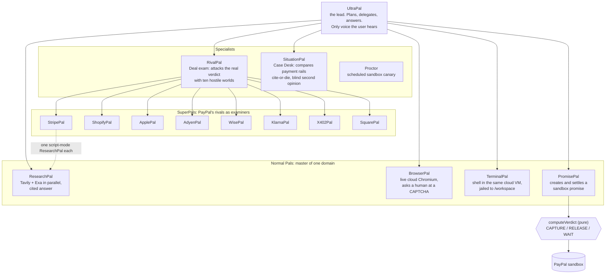

# The Pals: Ultra, Super and normal

UltraPals is one lead agent and a team of specialists. Every Pal has one domain, a hard list of tools it can touch, and no authority over money.
The only code that can move sandbox money is a pure function (`lib/verdict.ts`) called from one route. No Pal can call it.

## Normal Pals (workers)

| Pal | Domain | What it really does | What it cannot do |
|---|---|---|---|
| **ResearchPal** | the open web | Runs Tavily and Exa in parallel, merges and ranks sources, writes an answer with `[n]` citations that render as hover cards. Writes `*-sources.csv` and `*-notes.md` into the workspace. | Browse logged-in pages, run code, touch money |
| **BrowserPal** | a live browser | Drives a real cloud Chromium (KERNEL): look, act, look again. Knows when it is stuck at a CAPTCHA or login and hands the browser to the person, then resumes from the same page. Never types credentials. | Pass a wall by itself; it asks for you |
| **TerminalPal** | a shell | Runs commands, writes and edits files, serves a page, in the same VM as the browser. Paths are jailed to `/workspace`. File changes stream as green/red line diffs. | Leave the workspace, reach the database |
| **PromisePal** | sandbox money | Matches a premium Newsroom article, creates a promise, approves the order on the live browser, calls settle, returns the unlock URL. | Decide. It asks the route; the route asks the pure verdict |

## Specialists

| Pal | Job | The rule that keeps it honest |
|---|---|---|
| **RivalPal** | Examines a deal *before* it ships: researches how deals like it fail, spawns rivals, attacks the real `computeVerdict` with ten hostile worlds, prints a ladder and a seal. | **Cite or die.** A rival survives only if every source was fetched, every quote is a substring of the fetched page, and the counter points at developer.paypal.com. Pass lines live in a table; no model writes one. |
| **SituationPal** | Case Desk: takes an idea, picks its payment needs from a *closed* list, researches every rail in rounds until each (rail, need) pair has a cited answer or the budget ends. Runs real Stripe test-mode and Square sandbox probes. | Unknown is a band, never a zero. Missing evidence is HOLD. A blind reader from a *different model family* sees only the typed grid. The receipt is hashed and a person confirms it. |
| **Proctor** | Scheduled canary. Diff-first: an equal fingerprint stops with no further work. | Opens a case only on a *confirmed* change. A check that cannot run is `missed`, never "no change". Zero model calls. |

## SuperPals (rivals as examiners)

A **frozen** roster, so scores stay comparable run to run. Each row is one analyst-set bar on structure only (never milliseconds, fees or approval rates), with a provenance label.

| SuperPal | Rival | What it is measurably better at (the bar) | Needs a key? |
|---|---|---|---|
| StripePal | Stripe | typed errors, test clocks, no dashboard detours | `STRIPE_SANDBOX_KEY` |
| ShopifyPal | Shopify | the offer is machine-readable where agents shop | `SHOPIFY_SANDBOX_KEY` |
| ApplePal | Apple Pay | one tap, biometric, no forms | `APPLE_SANDBOX_KEY` |
| AdyenPal | Adyen | routes across rails | `ADYEN_SANDBOX_KEY` |
| WisePal | Wise | a quoted FX truth before the commit | `WISE_SANDBOX_KEY` |
| KlarnaPal | Klarna | defer and soften the price | `KLARNA_SANDBOX_KEY` |
| X402Pal | Coinbase x402 | machine-native capture with no human in the loop | none: measured from the run log |
| SquarePal | Square | sellers reachable inside ChatGPT and Claude | `SQUARE_SANDBOX_KEY` |

**A SuperPal row never gates the seal.** It is the competitive delta on the receipt: information for the next build, not a refusal.
A missing key reports `NOT_MEASURABLE` with the env name, never a pass.

The chain is `UltraPal -> RivalPal -> SuperPal -> ResearchPal`. `admitSpawn` (`lib/swarm/tree/policy.ts`) is the only place a spawn is allowed. It enforces reason, privilege, dedupe, repeat, depth, fan-out, node count, loop caps, budget share and deadline.
A child's tools, spawn kinds and budget are the **intersection** of its parent's (`attenuate`). The tool enum has no PayPal, database or money member, so no Pal at any depth can be handed one.

## Effort: how strong a Pal is

The pill in the prompt box changes which allowlisted models lead, how many race on each call, and how many planning rounds UltraPal gets. It never reaches a model that is not on the server roster.

| Level | Colour | Leads with | Models raced | Planning rounds |
|---|---|---|---|---|
| Light | green | GPT-OSS 20B | 2 | 4 |
| Standard | blue | free-model rotation across every provider | 2 | 6 |
| High | red | GPT-OSS 120B | 2 | 6 |
| Ultra | purple | Nemotron 3 Ultra 550B | 3 | 8 |
| Custom | | one pinned model, the rest as fallback | 1 | by level |

Effort has a colour and a size: the slider fill, the pill dots, UltraPal's gradient and halo, and every orb on screen follow it, and each step draws the orbs a little bigger.
Context rings show real token counts per call (exact from Groq, Bluesminds and OpenRouter; estimated, and labelled "about", where a provider sends none).

## Model and search providers

Free tiers only, rotated with a 429 cool-down so one rate limit never stops a run.

| Provider | Role |
|---|---|
| Groq | primary fast model (GPT-OSS 20B and 120B) |
| NVIDIA NIM | Nemotron family, flash models |
| Bluesminds | Nemotron Ultra 550B, Kimi |
| OpenRouter | `:free` models only. The suffix is enforced in code, so a paid model cannot be requested |
| TokenRouter | optional routed gateway models |
| Tavily + Exa | web search, run in parallel, merged and deduplicated |
| KERNEL | the cloud Chromium and shell VM |
