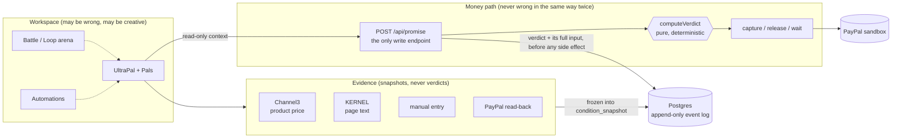
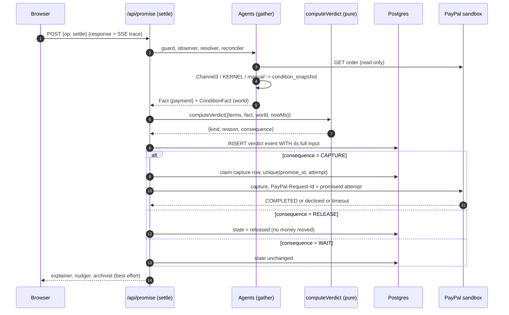
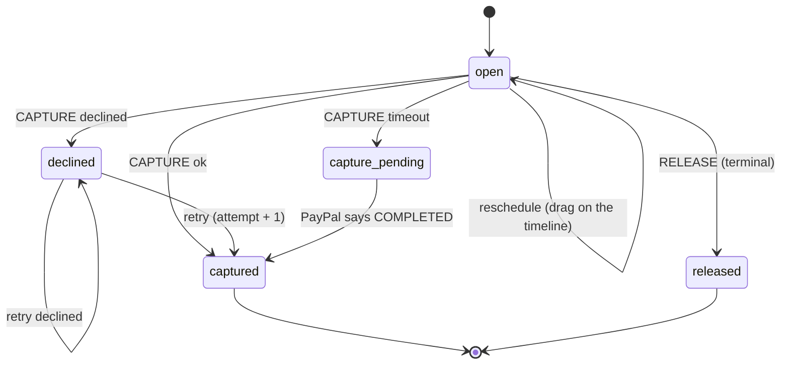
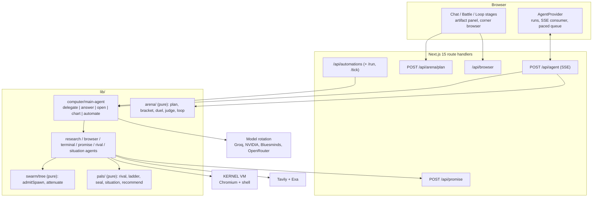

# System design

UltraPals has two halves that never trade authority:

* **The workspace.** UltraPal and its Pals research, browse, run commands, compare rails, argue (Battle), improve (Loop) and run unattended (Automations). They may be wrong. They are allowed to be.
* **The money path.** A payer commits an amount and an optional world condition. A pure function returns a verdict and the verdict carries its own consequence. One route performs it against the PayPal **sandbox**.

The first half can *gather* and *propose*. Only the second half can *decide*, and it is a function with no network, no clock and no model.

## The seven laws (each one is enforced by a hook or a script)

| # | Law | Enforced by |
|---|---|---|
| 1 | **Verdicts are pure.** `lib/verdict.ts` imports nothing, reads no clock, calls no network. Time arrives as `nowMs`. | `check-invariants.mjs` |
| 2 | **Money is integer minor units.** Strings only at the edges, through `lib/money.ts`. | invariant: no floats on the money path |
| 3 | **Agents gather, they never decide.** Nothing under `lib/agent/**` or `lib/computer/**` may mention `computeVerdict`. | invariant: agents never call `computeVerdict` |
| 4 | **Sandbox only.** A live key or `api.paypal.com` is a bug. | invariant: sandbox only |
| 5 | **`npm run verify` is green before every commit.** | commit hook |
| 6 | **Vendors produce snapshots, never verdicts.** Adapters return `AdapterResult`, run in `guard()`, and sit behind a `CAP_*` flag. "Could not see" is WAIT, never RELEASE. | invariant: integrations use `guard()` |
| 7 | **No vendor endpoint, header or field is written from memory.** It is read from the docs or the package types first. | process + `docs/APIMATIC-LOG.md` |

## One settle request

Order matters: the event row is written **before** the side effect, and the capture row is *claimed* before PayPal is called. A crash between the two leaves a claim that `resume` reconciles by asking PayPal what actually happened.

## The decision table (the whole product)

Payment is judged first. The world condition is only consulted once payment is fine. The set of reason codes is closed, and a script fails the build if the table, `REASON_CODES` and the test disagree.

| Payment fact | Window | Amount vs committed | World condition | Reason | Consequence |
|---|---|---|---|---|---|
| unavailable | any | n/a | n/a | `FACT_MISSING` | **WAIT** |
| observed (bad number) | any | non-integer or negative | n/a | `FACT_MISSING` | **WAIT** |
| observed | any | currency differs | n/a | `CURRENCY_MISMATCH` | **WAIT** |
| observed | open | less | n/a | `WINDOW_OPEN` | WAIT |
| observed | closed | less | n/a | `AMOUNT_SHORT` | RELEASE |
| none | open | n/a | n/a | `WINDOW_OPEN` | WAIT |
| none | closed | n/a | n/a | `WINDOW_EXPIRED` | RELEASE |
| observed | any | enough | none | `AMOUNT_MET` | CAPTURE |
| observed | any | enough | snapshot missing or wrong kind | `FACT_MISSING` | **WAIT** |
| observed | any | enough | price in another currency | `CURRENCY_MISMATCH` | **WAIT** |
| observed | any | enough | price at or under ceiling and in stock, or page contains text | `CONDITION_MET` | CAPTURE |
| observed | open | enough | condition false | `CONDITION_PENDING` | WAIT |
| observed | closed | enough | condition false | `CONDITION_UNMET` | RELEASE |

> **Not seeing is not the same as no.** A blind observer produces `unavailable`, which becomes `FACT_MISSING` and WAIT. The system never releases money because it could not look.

The window is closed when `nowMs >= windowEndsAtMs`. The ceiling is inclusive. A cheap but out-of-stock product is `CONDITION_PENDING`, not met.

## Promise state machine

## Replay: a judge can check our work

Every verdict event stores `{verdict, input}`. `GET /api/verdict/replay?promiseId=` recomputes it with the same pure function. The world moves; the answer does not, because the resolver *froze* what it saw in `condition_snapshot`. The replay button on every promise page does exactly this.

## Storage

| Table | Role | Key constraint |
|---|---|---|
| `promise` | terms, payer, `condition` (jsonb), `state` (a projection of the log) | money is `integer` minor units plus `char(3)` currency |
| `promise_event` | append-only log | insert only, never update or delete |
| `capture` | one row per capture attempt | `unique(promise_id, attempt)` is the idempotency guarantee |
| `condition_snapshot` | what a vendor saw, frozen | insert only; replay URLs are never inputs |

Everything else (conversations, saved battles, loop rounds) lives in the browser's `localStorage` on purpose: it holds no money and no secrets. Automations persist to `.data/automations.json`.

## Workspace architecture

Import rules are mechanical (see the graph at the bottom of [`CODEMAP.md`](CODEMAP.md)): components never import the database, integrations never import agents, and only `app/api/promise/route.ts` calls `computeVerdict`.

## Safety posture

* **Sandbox only.** A live PayPal key or `api.paypal.com` fails the build.
* **No Pal holds a money tool.** PromisePal calls the same HTTP route a person's browser calls; it cannot compute a verdict.
* **SSRF guard on every user URL**, re-checked per redirect hop (`lib/integrations/url-guard.ts`).
* **Untrusted page text is data.** `automate` only works when the *user's own message* contains a scheduling word, so a web page cannot talk UltraPal into creating a job.
* **Hard ceilings.** 8 automations, 12 runs per automation per 24 h, one run at a time, 8 minute timeout. Battle and Loop: 2 contests per minute per IP, 2 running at once. Automations cannot use `promise` or `automate`.
* **Credentials never reach a model.** The scripted sandbox-buyer approval runs on the VM; the email and password are never put in a prompt. A password or code field makes BrowserPal ask for a person.
* **Known limits, stated plainly:** there is no login (anyone who can reach the app can use it, inside the ceilings above), Proctor state is per process, and a throwaway disk loses `.data/` on redeploy.
